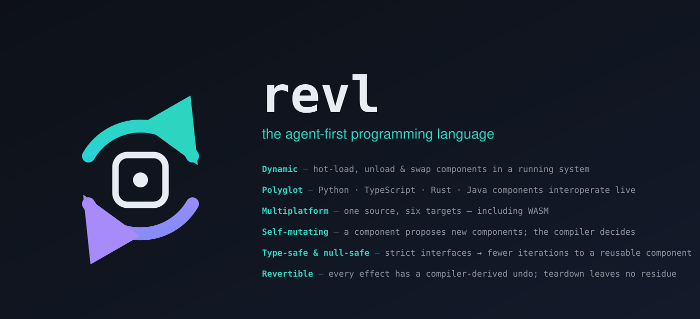
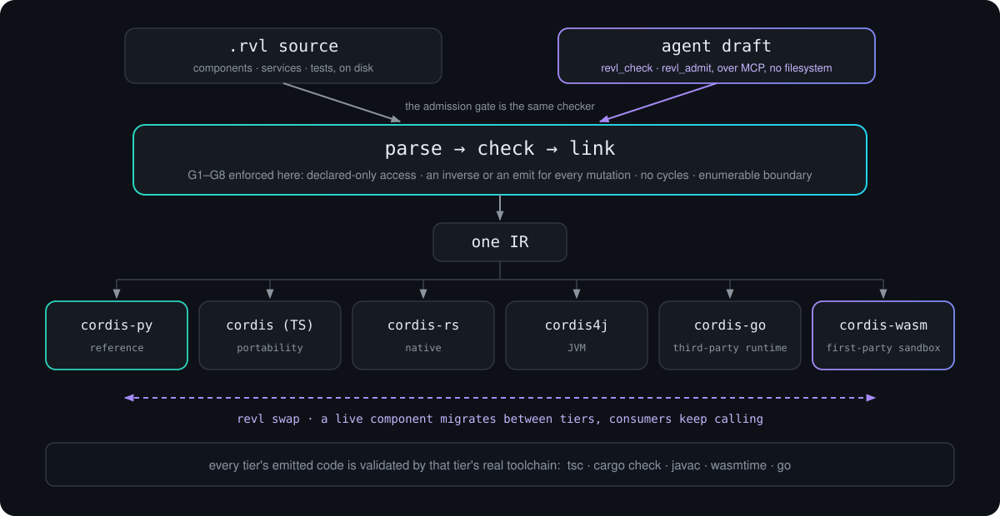

<div align="center">



<p>
  <a href="https://github.com/inso1337/revl/actions/workflows/ci.yml"></a>
  
  
  
  
  
  
</p>

<p>
  <b><a href="#quickstart">Quickstart</a></b> ·
  <a href="#what-makes-it-different">What makes it different</a> ·
  <a href="docs/README.md">Documentation</a> ·
  <a href="DESIGN.md">Design</a> ·
  <a href="docs/vision.md">Vision</a> ·
  <a href="docs/guide-ai-agents.md">For agents</a>
</p>

</div>

---

revl is a language for software that changes while it runs. Components
load, unload, and hot-swap inside a live system, and the properties that make
that survivable are checked at compile time: unloading leaves no residue,
dependencies stay coherent, nothing reaches state it never declared. The core
move is small and strict. Every mutation is written beside its inverse, and a
mutation with no inverse, one that crosses the system boundary, must carry an
`emit` marker at the call site. Irreversibility is legal; invisible
irreversibility is not.

The paradigm comes from [Cordis](https://github.com/cordiverse/cordis) and the
paper it implements, [*A Programming Paradigm for Spatiotemporal Composability*](https://github.com/cordiverse/paper).
The paper proves strong theorems about revertible effects, but each one rests
on hypotheses a library can only ask programmers to respect. revl moves those
hypotheses into the checker. C++ had RAII as a discipline and Rust made it a
type system; Cordis has revertible effects as a discipline and revl makes them
a language. The borrow checker governs lexical resource scope. revl's checker
governs dynamic component scope: what may enter a running system, what it may
touch while there, and what must be true when it leaves. What this project
claims, and what it deliberately does not, is [docs/vision.md](docs/vision.md).

```revl
service Database {
  emission fn execute(sql: Str) -> Int    // crosses the system boundary
}

service Cache {
  fn get(key: Str) -> Opt[Str]
  emission fn put(key: Str, value: Str)   // its body emits, so the interface says so
}

component UserCache requires db: Database provides cache: Cache {
  let store = effect Map.new() undo store.drop()   // every effect declares its inverse

  provide cache {
    fn get(key) = store.get(key)
    fn put(key, value) {
      effect store.insert(key, value)
      undo   store.remove(key)
      emit db.execute(`INSERT INTO cache_log VALUES (${key})`)
    }
  }
}
```

Read that as a contract the compiler enforces. Drop the `undo` and it will not
compile. Call `db.execute` without the `emit` marker and it will not compile.
Reach for a service the component never required and it will not compile.
Declare `put` as a plain `fn` while its body emits and it will not compile: a
service declaration is an upper bound on what its providers may do. Teardown is
derived, LIFO over exactly the effects that ran, and an `undo` body has no way
to register new effects because the grammar gives it nowhere to put one. Link
time rejects dependency cycles and two providers of one key. Nine guarantees,
G1 through G9, are the table in [DESIGN.md](DESIGN.md). G1 through G8 each
discharge a hypothesis the paper could only ask programmers to respect. G9 has
no paper anchor: it is revl's own, and it is where this project stops packaging
the paradigm and starts extending it.

## Quickstart

revl needs Python 3.11 or newer and is installed from source. The name `revl`
on PyPI belongs to an unrelated project, so do not `pip install revl`.

```bash
git clone https://github.com/inso1337/revl && cd revl
python3 -m venv .venv && source .venv/bin/activate
pip install -e .
```

With [uv](https://docs.astral.sh/uv/) the last two lines are
`uv venv && source .venv/bin/activate && uv pip install -e .`. To install a
tagged release without a checkout, use
`pip install "git+https://github.com/inso1337/revl@<tag>"`, with a tag from the
[releases page](https://github.com/inso1337/revl/releases). To run the test
suite, install the extra (`pip install -e ".[test]"`) and run `pytest tests/`.

With the virtual environment active, `revl` is on your PATH:

```bash
revl compile examples/user_cache.rvl   # source -> checked IR, printed as JSON
revl emit     examples/user_cache.rvl   # source -> emitted TypeScript (--backend picks another tier)
revl audit    examples/user_cache.rvl   # everything that can cross the boundary
revl mcp serve                          # the compiler as an agent admission gate
make demo                               # a live hot-swap, migration and rollback
make demo-flagship                      # one agent, ten steps, six refusals
```

`make demo` needs more than the install above: it runs
`backends/python/setup.sh` on first use (git, uv and network access) to build
the runtime it hot-swaps on. `revl mcp serve` prints the same pointer if that
runtime is missing and starts with the live verbs unavailable.

The `revl` console script is the documented happy path. The
absolute-interpreter fallback is `python -P -m revl` (PYTHONSAFEPATH, 3.11+).
The `-P` matters: without it, the current directory can shadow the installed
package (issue #336; issue #317 is the underlying mechanism).

The language reference is [docs/syntax-2.0.md](docs/syntax-2.0.md); if the
component author is a model, start with the
[agent guide](docs/guide-ai-agents.md) instead.

## What makes it different

### The undo is checked, not hoped for

Undo logic is the classic write-only code path: written once, wrong quietly,
exercised at the worst possible moment. revl refuses the quiet part. Code
outside `effect` forms is pure, so the accumulator provably holds every
mutation, and the emission marker keeps the two kinds of change, revertible and
not, distinct in the types. When a component deactivates, the runtime replays
inverses in reverse order and the environment is exactly what it was before
activation. That property is what the whole language is shaped around.

### The gate defends against the component's author

The reversibility theorems come from the paper. The admission gate does not.
revl treats its input as hostile, because increasingly that input is written by
an agent optimising for "make the tool say yes," and such an author will phrase
a side effect however it must to slip past a name-based check. So the checks are
not name walks. When a generated MCP tool advertises `readOnlyHint: true`, revl
has proved the operation reaches no irreversible host effect, through an emission
fixed point that follows an effect even when it is handed around as a value and
fired one indirection later. An effect that escapes its declaration does not
compile.

On top of the eight paradigm guarantees, revl adds a security discipline the
paper never described, enforced by the same checker. G9 refuses authority
manufactured from untrusted data unless a declassification is declared and
audited, a static defense against prompt injection. Capability-bound `Secret`
values cannot reach a log, a serializer, an LLM prompt, or an undeclared
receiver. A further family of rules governs async boundaries, acquisition order,
and provider signatures. The properties an attacker would have to break, and the
executable suite that tries to break them, are in
[docs/threat-model.md](docs/threat-model.md).

### One front end, six live runtimes

<div align="center">



</div>

One front end parses, checks, and links `.rvl` into a single IR. Six emitters
lower that IR to six hardened Cordis runtimes: cordis-py (reference), cordis
(TypeScript), cordis-rs (Rust), cordis4j (Java), cordis-go (Go), and the
first-party cordis-wasm sandbox. This is not six ports of a demo. Components
built for different runtimes compose in one running system across process
boundaries, a Python component consuming a service a Rust component provides
([docs/interop-bridge.md](docs/interop-bridge.md)). And the claim that all six
tiers agree is measured, not asserted: every construct is emitted through every
backend and the output is handed to that tier's real compiler, `tsc`, `cargo
check`, `javac`, `wasmtime`. The construct-by-tier matrix lives in
[docs/conformance.md](docs/conformance.md), regenerated by `make matrix` and
gated in CI. Where a tier genuinely cannot agree, the conformance suite pins the
divergence and names it rather than hiding it, so a difference between runtimes
is a documented fact instead of a surprise in production.

### The compiler is the agent's interface

If components are increasingly written by AI agents, the question that matters
is whether a generated component is safe to deploy into a system that is
already running. revl's answer is to make the compiler the admission gate.
`revl mcp serve` (to connect it to an MCP client working on your own project,
see [the client recipe](docs/guide-ai-agents.md#wiring-revl-mcp-serve-into-a-working-session))
gives an agent `revl_check` and `revl_admit` instead of
filesystem access: drafts are held server-side, edited by delta, and nothing
lands until the same checker that guards human commits says yes. A rejected
candidate cannot deploy, and every rejection carries the guarantee it violated
plus the rewrite that fixes it. Tool safety annotations are derived from the
method body rather than asserted by an author, so a tool cannot call itself
read-only when it emits. One tracked run of the Python gate measured the
in-process `compile_source(..., manifest=running)` round-trip at a median of
**0.165 ms** for a small candidate against a two-component running composition
on an Apple M1 Max / Python 3.14.3. This is not MCP transport latency.
`tests/test_admission_latency.py` holds a 20 ms ceiling, which is only a
regression guard, not a performance claim. See the
[measurement](bench/results/admission-latency.md) and a
[worked MCP admission example](docs/mcp-admission-walkthrough.md).
[docs/mcp-bridge.md](docs/mcp-bridge.md) has the shapes;
[docs/guide-ai-agents.md](docs/guide-ai-agents.md) has the workflow.

### Tooling that operates a running system

Because the compiler knows every effect and its inverse, it can answer
questions no ordinary toolchain can. The `swap` verb of `revl run --placement`
(a REPL verb, not a `revl` subcommand) migrates a live component to another
runtime tier, re-pointing every consumer across the cutover and ending with a
proof the old provider left nothing behind
([docs/swap.md](docs/swap.md)). `revl plan` shows the exact delta a hot-swap
would produce and `revl apply` executes it with a derived rollback, so a
mid-plan failure unwinds by inverses instead of by hand
([docs/plan.md](docs/plan.md), [docs/apply.md](docs/apply.md)). `revl why`
prints the derivation behind a rejection or a runtime transition
([docs/why-traces.md](docs/why-traces.md)).

### Placement is an isolation boundary, not just a tier choice

A component can declare an isolation boundary and a capability envelope, no
disk, no network, or an explicit allowlist, and run inside a wasm cell, a
container, or a microVM while still composed with the rest of the system over
the ordinary process seam (value copy, audited crossings). The envelope is
checked statically and enforced at runtime: a component whose declared
capabilities exceed the sandbox grant is refused before anything launches, and
inside the boundary the container runtime or hypervisor is the enforcer. That is
what turns the untrusted-author and taint guarantees from checked into
physically enforced, since an opaque host body confined to no network cannot
exfiltrate what the audit cannot see inside it. The ladder runs from wasm cell
(in process, weakest) through container to microVM (its own kernel, strongest),
one capability contract at three enforcement strengths. The container rung hosts
a component today, and the microVM rung boots a guest and confirms the boundary
from inside, with in-guest hosting the next step
([docs/design/411-sandbox-placement.md](docs/design/411-sandbox-placement.md)).

### Deployment is a coordinated transaction, not a copy

`revl deploy` admits a deployment map and drives a coordinated PREPARE then
COMMIT across the composition's participants, so a partial failure rolls back in
reverse commit order instead of leaving a half-applied system. When the
deployment names an attested bundle, the receiver re-verifies the whole chain,
from source to IR hash to artifact hash to capability policy to evidence to
signature, by re-hashing the bytes it will actually run rather than trusting the
attestation's own claims, and refuses to load anything whose hash, backend,
capabilities, or policy drifted. Every effect that crosses a boundary carries a
correlation identity for recovery and duplicate detection. The coordinated
multi-process deploy runs today; the cross-machine leg, an ssh runner that
speaks the same protocol behind a pinned host key, is landing, and a replicated
write-ahead log for partition-safe distributed commit stays deferred
([docs/deploy.md](docs/deploy.md)).

### Crash recovery is derived, not bolted on

The effect accumulator is already an ordered list of actions paired with their
inverses, so it persists directly as a write-ahead log, with no separate recovery
framework to write or trust. `revl recover` walks that log after a `kill -9` and
reports, per effect, what is moot, what compensates, and what must be undone
([docs/crash-recovery.md](docs/crash-recovery.md)). The engineering around it is
where the guarantee actually has to hold. A reclaim fence closes the crash window
so a half-written entry cannot be replayed as complete. Run-complete scoping
stops a reused log from reporting a false CLEAN. An operator E-Stop strands the
in-flight decision without tearing down what is still legitimately owned, and a
re-armed disposer keeps that ownership rather than dropping it. This is the part
that matters for agents and distributed teardown, and it is where much of the
recent work lives.

### What is proved, and what is deliberately not

The paradigm's metatheorems transfer by construction: the research claim is a
surface language whose every well-typed program satisfies the calculus's
hypotheses, not new type theory. What revl proves in Lean is part of its own
admission judgment. In [formal/](formal/), G2 through G9 are `full` at the
granularity each row of the ledger states (the G4 and G8 shape-level statements
are marked weak, and G6 is head-granularity): axiom-gated with no `sorry`,
carrying non-vacuity witnesses and, where the ledger records one, a differential
oracle against the shipped checker. G1 is `partial`, and the remaining rows are
partial or still in progress, each for a named modelling reason, and
`formal/STATUS.md` is the per-theorem ledger, written to be read gap-first. The live source of truth for the checker is still the
implementation and its golden and adversarial tests; the Lean layer is a growing
backbone under that, not a finished metatheory, and CI's `formal` job keeps the
distinction honest.

### It compiles itself, and disagreement is a bug report

`selfhost/compile.rvl` is the revl compiler written in revl. Where its native
pipeline runs today (59 of the 61 constructs in the conformance matrix, with no
reference compiler in the chain), its output is byte-identical to the
reference compiler, which makes self-hosting more than a stunt: two independent
implementations of one grammar run the same input, and any divergence is a real
defect in one of them. The two remaining constructs are `component/block effect setup` and
`fn/verified fn`.

The self-host gate is not yet the reference gate. It does not implement the G5,
G7, G9, A2, A8, A9, G-RETAIN and G-SECRET-FLOW checks, and it diverges from the
reference on a few reproducers of G1, G2, G3 and G6.
[docs/conformance.md](docs/conformance.md) has the per-construct `revl` column
and the per-guarantee list of what the self-host gate does not refuse. The
defects this differential oracle has already caught are written up in
[docs/selfhost-findings.md](docs/selfhost-findings.md).

The supporting cast is what you would expect from a checked language, done
plainly: bidirectional type checking, no `null` (absence is `Opt[T]` and never
silently unwraps), exhaustive `match`, and an extern boundary that must
classify itself as `pure`, `acquire`, or `emission` before it compiles, so
`revl audit` can enumerate everything a component could ever do to the world.

## Documentation

The full index is **[docs/README.md](docs/README.md)**. Start here:

- **[DESIGN.md](DESIGN.md)** for the guarantees and the checked table, **[docs/vision.md](docs/vision.md)** for what this is for and the honest scope of the claims
- **[docs/guarantees.md](docs/guarantees.md)** the guarantees and rules at a glance, with origins (decode a cited `G4`, `T2`, or `A8`)
- **[docs/syntax-2.0.md](docs/syntax-2.0.md)** the language reference, **[docs/stdlib-2.0.md](docs/stdlib-2.0.md)** the stdlib surface
- **[docs/guide-ai-agents.md](docs/guide-ai-agents.md)** the agent workflow, **[docs/mcp-reference.md](docs/mcp-reference.md)** every MCP verb, **[docs/commands-reference.md](docs/commands-reference.md)** every subcommand
- **[docs/conformance.md](docs/conformance.md)** every construct against every tier, **[docs/crash-recovery.md](docs/crash-recovery.md)** the WAL and what honestly survives a crash
- **[CHANGELOG.md](CHANGELOG.md)** what changed in each release, **[docs/v2.0-roadmap.md](docs/v2.0-roadmap.md)** what is done and what is in flight, **[CONTRIBUTING.md](CONTRIBUTING.md)** the workflow and the pre-commit contract

## Acknowledgments

revl is the language-level realization of
[Cordis](https://github.com/cordiverse/cordis) and the paradigm of its
[paper](https://github.com/cordiverse/paper); it exists because the runtimes it
lowers to do. With gratitude to
[cordis-py](https://github.com/geohotstan/cordis-py),
[Cordis](https://github.com/cordiverse/cordis) (TypeScript),
[cordis-rs](https://github.com/dshbox/cordis-rs),
[cordis4j](https://github.com/1na-ko/cordis4j),
[cordis-wasm](https://github.com/inso1337/cordis-wasm), and
[stc-go](https://github.com/0xdenny218/stc-go), and to the toolchains that
build and validate every tier ([pytest](https://github.com/pytest-dev/pytest),
[TypeScript](https://github.com/microsoft/TypeScript),
[Wasmtime](https://github.com/bytecodealliance/wasmtime),
[Serde](https://github.com/serde-rs/serde), and more).

## License

The compiler, the admission gate and the tooling are
[AGPL-3.0-only](LICENSE). Everything that ends up inside your program, the
`stdlib/`, the runtime shims under `backends/`, the examples, is
[MIT](LICENSES/MIT.txt), and the code revl emits from your source is yours.
The split, file by file, is in [LICENSING.md](LICENSING.md). The names revl and
truc and the logo are trademarks; see [TRADEMARK.md](TRADEMARK.md).
