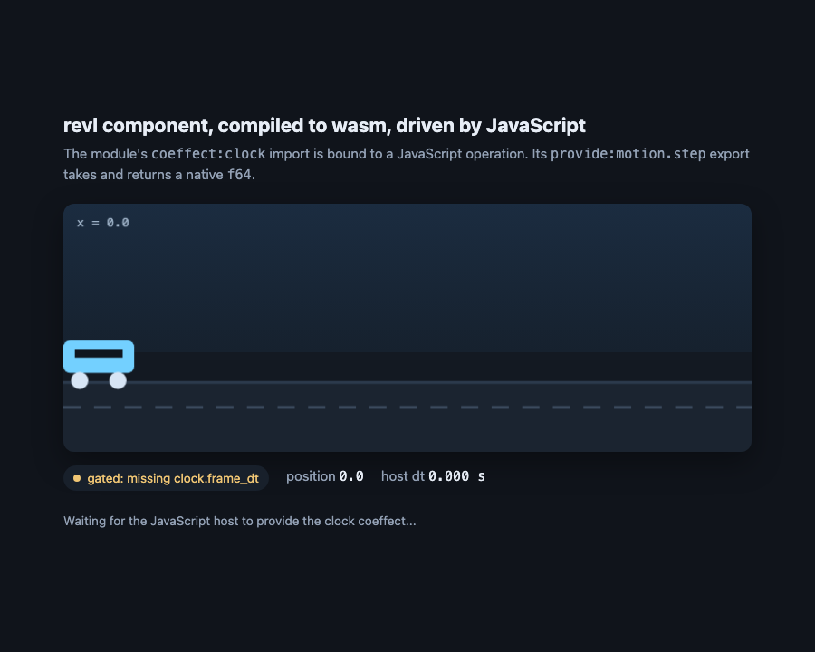
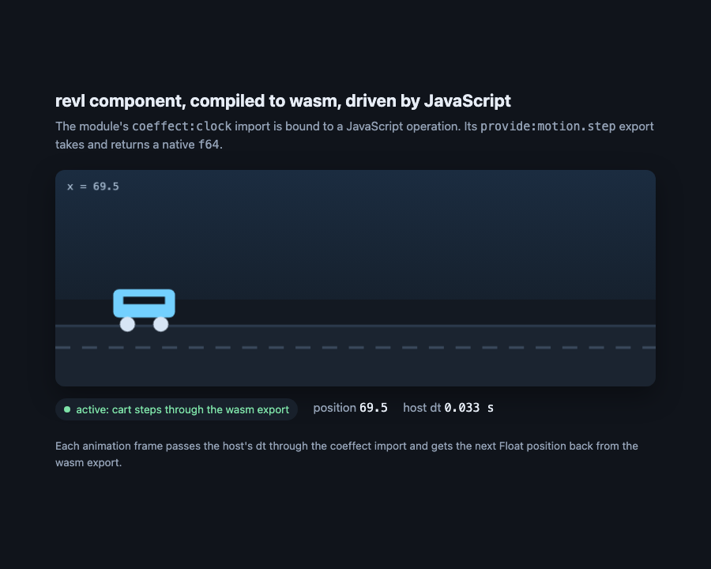

# The browser host

A small JavaScript host for components compiled by `backends/wasm/emit.py`. It
carries the part of the cordis-wasm seam a browser page needs:

* a module's `coeffect:<key>` imports are its dependencies. The host resolves
  one from `provideHost(key, ops)` or from another loaded component's
  `provide:<key>.<op>` export. The ops are the OWN function properties of
  `ops`: an inherited name (`constructor`, `toString`, a class instance's
  prototype method) is not an op, so pass a class instance as a plain object,
  e.g. `provideHost("clock", { now: () => clock.now() })`;
* a component whose coeffects are unresolved is **gated**: its module is
  compiled but no instance is created. Supplying the missing op activates it,
  exactly as cordis-wasm's linker refuses to instantiate it;
* activation is driven by `activate_step() -> i32`, teardown by `deactivate()`,
  and `provide:` exports are published only after activation;
* a component that cannot activate (a provision conflict, found from its
  export list before it is instantiated; a trap in `activate_step`; the step
  limit) is **failed**: a partly run activation is undone with `deactivate`,
  it publishes nothing, `error(name)` says why, and only its own `load`
  rejects. One that activates later, while another component's load or a
  `provideHost` call drives the host, fails without rejecting that call;
* the states are `loading` (compiling; the name is already reserved),
  `gated`, `activating` (the instance exists and `activate_step` is running;
  nothing is published and `call` refuses), `active` and `failed`. A failed
  component holds no instance and is never retried;
* re-entrant calls are deferred: a `load`, `unload` or `provideHost` made from
  inside `activate_step`, `deactivate`, a start function, an export reached
  through `call`, or the `log` callback is applied when the outer host
  operation finishes, in the order it was made (`load` still returns a
  promise, which settles then). The one exception is `unload` of the
  component that is activating: its activation stops at the next step,
  `deactivate` runs once, and its `load` rejects with "was unloaded while it
  was activating", even if the activation then traps;
* a deferred `unload` returns true when the name will be loaded by the time
  it runs. If that component's `deactivate` then throws, the caller has
  already seen true, and the error goes to the `log` callback;
* a deferred `unload` of a gated component runs after the outer operation,
  so if that operation publishes what the component was waiting for, it may
  activate (and run its own activation) before the unload removes it;
* `load` resolves to a frozen snapshot `{ name, state, missing }`, not the
  host's record: `call` is the only way into a component's exports;
* `deactivate` runs at most once per activation. A `log` callback that throws
  on the `active <name>` line fails that component (nothing was published
  yet); a throw on any other line is ignored;
* `__checkInvariant()` is for tests only: it throws when the invariant written
  at the top of `CordisHost` does not hold (every published op belongs to an
  `active` component, every `active` component has its instance and all its
  provisions published, a `failed` or removed one has neither and ran its
  `deactivate` exactly once if it was activated, and nothing at rest is
  `activating` or has a pending unload);
* only a FUNCTION export named `provide:<key>.<op>` is a provision: a memory
  or global exported under such a name is not published and does not count
  in a conflict;
* scalar values cross as native WebAssembly values, so a `Float` is an `f64`
  (a JavaScript `number`) with no marshalling. An `Int` is a wasm `i64`, which
  the JS API represents as a `BigInt`, and `Bool`/`Int32` as `number`/`i32`.
  A compound value (Str/List/record/…) crosses as an `i32` pointer into the
  module's exported `memory`; this host does not lift those for you.

It is the synchronous base calculus on purpose. The async inertia layer
(`host.job_run`), routed realms, `spawn` and the instance accessors need the
cordis-wasm runtime's state machine and are refused by name instead of bound to
a wrong function. There is no reactive withdrawal either: unload dependents
before their provider.

## Files

| file | what it is |
|---|---|
| `cordis-host.mjs` | the host (`CordisHost`) |
| `demo.rvl` | the demo component: `Cart` requires `clock: Clock` and provides `motion: Motion` |
| `demo.wat`, `demo.wasm` | the compiled demo, checked in as generated artifacts |
| `build_demo.py` | regenerates the two artifacts; `--check` is the staleness gate |
| `index.html` | the page: binds `clock.frame_dt` to an animation frame and draws the Float position `motion.step` returns |
| `test_host.mjs` | node test of gating, activation and Float calls |
| `screenshot-gated.png`, `screenshot-active.png` | the page before and after the host supplies the `clock` coeffect |

The two captures are the same page, viewport and theme. Before the coeffect
arrives the component is gated (`missing clock.frame_dt`) and the cart does not
move; once `provideHost("clock", …)` runs, the cart's position advances through
`provide:motion.step` on every animation frame.




## Run the page

Serve the directory over HTTP (ES modules and `fetch` do not work from
`file://`):

```bash
cd backends/wasm/host
python3 -m http.server 8080
# open http://localhost:8080/
```

The page shows the component gated on `clock.frame_dt` and then active once the
page supplies it.

## Use the host

```html
<script type="module">
  import { CordisHost } from "./cordis-host.mjs";

  const host = new CordisHost();
  const bytes = await (await fetch("./demo.wasm")).arrayBuffer();
  await host.load("Cart", bytes);              // gated: clock not provided yet
  host.provideHost("clock", { frame_dt: () => 1 / 60 });
  const next = host.call("Cart", "provide:motion.step", 100);
</script>
```

`load` also accepts a `Response`, an `ArrayBuffer` or a typed array, so a module
built elsewhere can be handed in directly.

## Verify

```bash
node backends/wasm/host/test_host.mjs
python3 backends/wasm/host/build_demo.py --check
```

`test_host.mjs` proves the gate: the component is not instantiated until the
coeffect arrives, its Float export answers through the host, a replaced host
op is read on the next call, and unload removes the component. The Python test
`backends/wasm/test_browser_host.py` runs both commands in CI.
